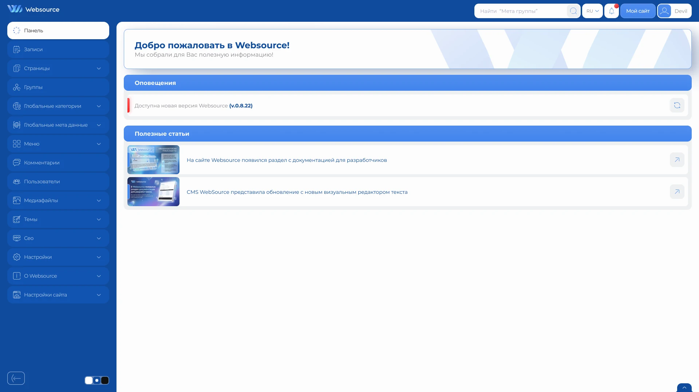
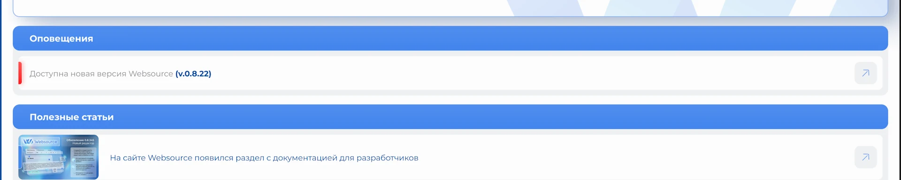

# Главная страница панели управления

Главная страница открывается после входа в административную панель и показывает важные сведения о состоянии сайта.

## Как открыть страницу

Откройте административную панель или выберите пункт «Панель» в боковом меню.

Пункт расположен первым в списке разделов и возвращает на главную страницу из любого другого раздела.

## Что находится на странице

Главная страница содержит:

- приветственный блок
- системные оповещения
- список полезных статей

Блок оповещений появляется только при наличии информации, требующей внимания.

## Системные оповещения

Оповещения сообщают о событиях, которые могут потребовать действия администратора:

- доступна новая версия CMS
- обнаружена проблема с лицензией
- структура базы данных не соответствует текущей версии CMS

Если для оповещения доступно действие, справа отображается кнопка перехода к нужному разделу или странице поддержки.

Отсутствие блока оповещений означает, что новых системных сообщений нет.

## Полезные статьи

В блоке «Полезные статьи» отображаются материалы, связанные с использованием и обновлением CMS Websource.

Для каждой статьи могут отображаться:

- изображение
- название
- кнопка перехода

Статья открывается в новой вкладке.

Если материалы временно недоступны или ещё не опубликованы, вместо списка выводится соответствующее сообщение. Это не влияет на работу административной панели.

## Важные замечания

- состав оповещений зависит от текущего состояния сайта
- блок оповещений может отсутствовать
- для загрузки полезных статей требуется соединение с сервисом Websource
- недоступность статей не блокирует работу с сайтом