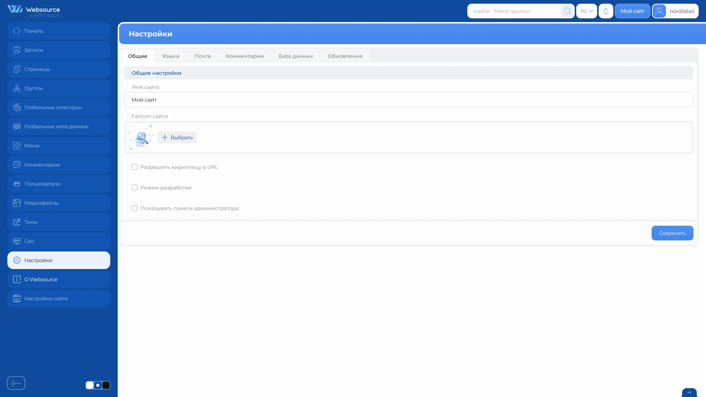
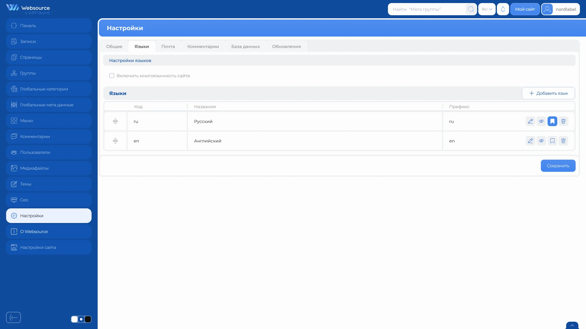
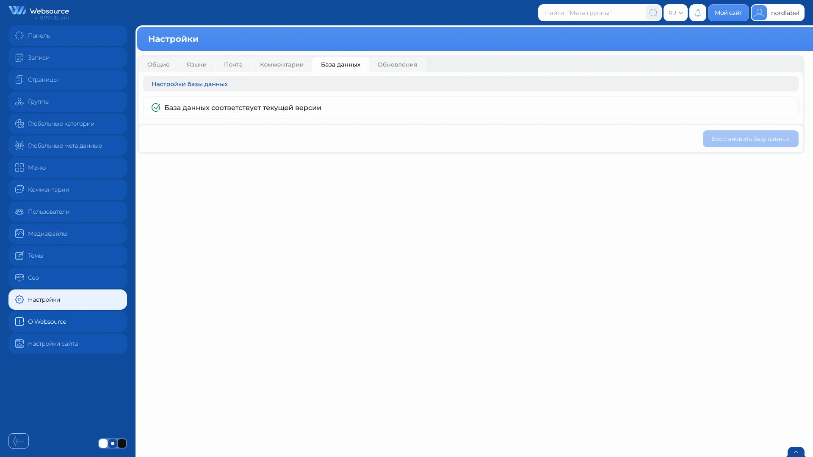

# Настройки сайта

Раздел «Настройки» содержит основные параметры сайта и инструменты управления языками, почтой, комментариями, состоянием базы данных и обновлениями CMS.

Каждая вкладка сохраняется отдельно.

## Как открыть настройки

1. Откройте административную панель.
2. Выберите пункт «Настройки» в боковом меню.
3. Перейдите на нужную вкладку.

## Общие настройки

Вкладка «Общие» содержит основные параметры сайта.

| Настройка | Назначение |
|---|---|
| Имя сайта | Название сайта, используемое CMS. |
| Favicon сайта | Значок сайта для вкладки браузера. |
| Разрешить кириллицу в URL | Позволяет использовать кириллические символы в адресах страниц и записей. |
| Режим разработки | Глобальный параметр режима разработки, который могут учитывать компоненты сайта. |
| Показывать панель администратора | Управляет отображением панели администратора для текущего пользователя. |

Для favicon поддерживаются изображения в форматах SVG, PNG, JPG, JPEG, GIF и WebP.

После выбора нового изображения отображается его предварительный просмотр. Чтобы применить изменение или удалить текущий favicon, нажмите «Сохранить».

## Языки

Вкладка «Языки» позволяет настроить мультиязычность сайта.

### Добавление языка

Нажмите «Добавить язык» и заполните поля:

| Поле | Описание |
|---|---|
| Код | Уникальный код языка, например `ru` или `en`. |
| Название | Название языка, отображаемое в административной панели. |
| Префикс | Уникальный префикс языка в URL, например `ru` или `en`. |

Код и префикс могут содержать строчные латинские буквы, цифры и дефис.

Префикс `admin` зарезервирован для административной панели и не может использоваться для языка.

Первый добавленный язык автоматически становится активным и используется по умолчанию. После создания код языка изменить нельзя, но можно изменить его название и URL-префикс.

### Управление языками

Для каждого языка доступны следующие действия:

- редактирование названия и префикса
- включение и отключение
- выбор языка по умолчанию
- удаление
- изменение порядка перетаскиванием

Язык по умолчанию всегда остаётся активным. При выборе нового языка по умолчанию CMS автоматически включает его.

На сайте должен оставаться хотя бы один активный язык. Последний оставшийся язык удалить нельзя.

Чтобы включить мультиязычность сайта, сначала добавьте хотя бы один язык, затем включите настройку «Включить многоязычность сайта» и нажмите «Сохранить».

## Почта

Вкладка «Почта» содержит параметры отправки электронных писем.

| Настройка | Назначение |
|---|---|
| Имя отправителя | Имя, которое получатель увидит в письме. |
| Email отправителя | Адрес отправителя и получателя тестового письма. |
| SMTP логин | Логин для подключения к SMTP-серверу. |
| SMTP пароль | Пароль для подключения к SMTP-серверу. |
| SMTP сервер | Адрес SMTP-сервера. |
| SMTP порт | Порт SMTP-сервера. |
| Кодировка | Кодировка отправляемых писем: UTF-8 или Windows-1251. |
| Использовать SMTP | Включает отправку писем через SMTP. |

Если используется SMTP, укажите параметры, предоставленные почтовым сервисом.

Кнопка «Проверить почту» отправляет тестовое письмо с текущими значениями формы. Успешная проверка не сохраняет настройки, поэтому после неё отдельно нажмите «Сохранить».

Не размещайте SMTP-пароль в скриншотах, сообщениях об ошибках и общедоступных материалах.

## Комментарии

Вкладка «Комментарии» управляет предварительной проверкой новых комментариев.

Если включить настройку «Не проверять комментарии перед публикацией», новые комментарии будут публиковаться без предварительной модерации.

После изменения нажмите «Сохранить».

## База данных

Вкладка «База данных» показывает, соответствует ли структура базы данных текущей версии CMS.

Если проблем нет, отображается сообщение о соответствии базы данных текущей версии, а кнопка восстановления недоступна.

При обнаружении несоответствий отображается список проблем и становится доступна кнопка «Восстановить базу данных». Перед восстановлением рекомендуется создать резервную копию сайта и базы данных.

После операции CMS повторно проверяет состояние базы данных и сообщает, были ли устранены все найденные проблемы.

### Незавершённое обновление

Если обновление CMS не завершено, на вкладке «База данных» отображается предупреждение: «Обновление не завершено. Нажмите „Восстановить базу данных“, чтобы повторить попытку».

1. Убедитесь, что у вас есть резервная копия сайта и базы данных.
2. Нажмите «Восстановить базу данных».
3. Дождитесь результата операции.

CMS повторит попытку завершения обновления. При успешном завершении страница автоматически перезагрузится, после чего появится уведомление об успешном обновлении CMS.

Если завершить обновление не удалось, ознакомьтесь с сообщениями о проблемах на вкладке «База данных».

Пока предыдущее обновление не завершено, CMS не запускает новое обновление.

## Обновления

Вкладка «Обновления» показывает текущую версию CMS, состояние лицензии и наличие новой версии.

Доступны два канала обновлений:

| Канал | Назначение |
|---|---|
| Стабильный | Выпущенные стабильные версии CMS. |
| Beta | Предварительные версии для тестирования. |

Введите лицензионный ключ, выберите канал и нажмите «Сохранить».

Кнопка «Обновить» появляется только при наличии более новой версии. Перед обновлением рекомендуется создать резервную копию файлов сайта и базы данных.

Если CMS сообщает о незавершённом обновлении, перейдите на вкладку «База данных» и используйте кнопку «Восстановить базу данных». Повторное нажатие «Обновить» не заменяет этот шаг.

Не публикуйте лицензионный ключ и не оставляйте его видимым на скриншотах.

## Важные замечания

- настройки каждой вкладки сохраняются отдельно
- проверка почты не заменяет сохранение настроек
- настройка панели администратора относится к текущему пользователю
- перед восстановлением базы данных или обновлением CMS рекомендуется создать резервную копию
- SMTP-пароль и лицензионный ключ не должны попадать в общедоступные материалы