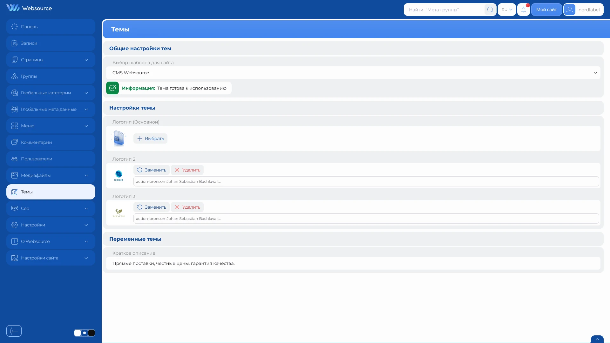

# Управление темами

Раздел «Темы» позволяет выбрать одну из установленных тем сайта и изменить предусмотренные её разработчиком настройки.

Состав доступных полей зависит от выбранной темы.

## Как открыть раздел

1. Откройте административную панель.
2. Выберите пункт «Темы» в боковом меню.
3. Выберите тему в поле «Выбор шаблона для сайта».

При открытии страницы в списке выбрана текущая тема сайта. Рядом с названием темы могут отображаться имя автора и версия.

## Выбор темы

После выбора темы CMS загружает её состояние и доступные настройки.

Чтобы активировать тему:

1. Выберите тему в списке.
2. Проверьте сообщение о её состоянии.
3. Заполните доступные настройки.
4. Нажмите «Сохранить».

Выбор темы в списке сам по себе не меняет оформление сайта. Новая тема становится активной только после сохранения.

## Состояние темы

После выбора отображается сообщение о готовности темы.

| Сообщение | Что означает |
|---|---|
| Тема готова к использованию | Тема имеет корректную структуру и может быть активирована. |
| У темы нет настраиваемых полей | Тему можно активировать, но дополнительных настроек у неё нет. |
| Отсутствует файл описания темы | CMS не может получить обязательные сведения о теме. |
| Отсутствует основной файл темы | Структура темы не завершена. |
| Неверная структура темы | CMS не может использовать выбранную тему. |
| Файл настроек повреждён | Настраиваемые поля темы описаны неверно. |

Если тема не готова к использованию, кнопка «Сохранить» становится недоступной. В этом случае выберите другую тему или обратитесь к её разработчику.

## Настройки темы

Если тема предоставляет общие настройки, они отображаются после её выбора.

Набор полей может включать текстовые значения, изображения, переключатели, списки и другие элементы. Назначение каждого поля определяется выбранной темой.

Изменения применяются вместе с выбором темы после нажатия кнопки «Сохранить».

## Переменные шаблона

Некоторые темы предоставляют отдельную группу «Переменные шаблона».

Такие переменные позволяют изменять предусмотренные темой значения оформления или содержимого без редактирования её файлов. Состав и назначение переменных зависят от конкретной темы.

Если у темы нет переменных шаблона, этот блок не отображается.

## Темы без настроек

Тема может не содержать настраиваемых полей. В таком случае на странице остаются только выбор темы, сообщение о её состоянии и кнопка сохранения.

Отсутствие дополнительных полей не мешает активировать корректную тему.

## Для разработчиков тем

Интерфейс показывает только настройки, объявленные самой темой.

Создание новой темы описано в руководстве [«Создание темы»](/ru/developer/development/themes/latest/creating-theme).

Добавление изменяемых полей описано в руководстве [«Настройки темы»](/ru/developer/development/themes/latest/theme-settings).

## Важные замечания

- новая тема становится активной только после нажатия кнопки «Сохранить»
- смена темы может сразу изменить внешний вид и структуру страниц сайта
- набор настроек зависит от выбранной темы
- тема с ошибкой структуры не может быть активирована
- перед сменой темы рекомендуется проверить её на тестовой версии сайта